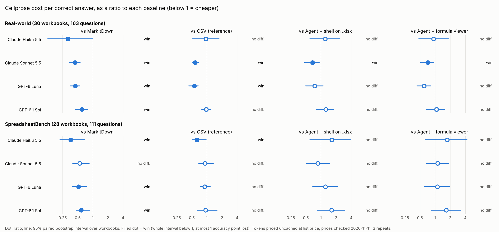

# Cellprose

**Give a model the whole spreadsheet, formulas included, and it answers right in one call.**

Created by Utkarsh Gaikwad.

Cellprose (`.sheet.md`, or `.cellprose.md`) is an open plain-text format for Excel workbooks. It keeps what CSV and
MarkItDown drop: formulas, cell addresses, merged cells, number formats and named ranges. Every file is still valid
GitHub-Flavored Markdown, so workbooks render as tables and diff cleanly on GitHub.



## What the benchmark showed

A pre-registered run on 11 Nov 2026: protocol, code and data frozen and the digest
[posted publicly](https://gist.github.com/Utkarsh-Gaikwad/216cc9dc28d31f4cf616f44e77324c82) before the first call.
Four models (Claude Haiku 5.5 and Sonnet 5.5, GPT-6 Luna and GPT-6.1 Sol), 3 repeats, every token priced as
uncached. Full tables: [benchmarks/RESULTS.md](benchmarks/RESULTS.md).

- **Accuracy in one call.** On 30 real-world workbooks (163 questions), the workbook sent once as Cellprose got
  93.8–99.3% right across the four models, against 65.9–84.1% for CSV and 70.0–85.7% for MarkItDown. The gap is in
  questions about formulas (trace, impact, hardcoded numbers), which CSV and MarkItDown cannot carry.
  *Limit: the questions are generated by rule from the workbooks, not written by their authors.*
- **Cheaper than MarkItDown.** Cellprose cost 0.32–0.60 times as much per correct answer, a win in 7 of 8
  model-and-corpus pairs; the eighth (Sonnet on SpreadsheetBench) is no difference under the 1-point accuracy rule.
  *Limit: 30 and 28 workbooks, so intervals are wide, Haiku's widest.*
- **Against CSV,** wins for Sonnet and Luna on the real-world set and for Haiku on SpreadsheetBench; the rest are no
  difference. *Limit: on SpreadsheetBench's value questions CSV already scores 83.5–99.7%.*
- **Against an agent that opens the `.xlsx` with a shell,** accuracy is within a few points on most models (up to 3.8 points lower for Cellprose on some), but the agent
  takes 3.5–4.6 turns per question. Cellprose wins on cost for Sonnet on the real-world set; the other 14 of 16 comparisons are no
  difference. *Limit: one-shot and agent loops spend tokens differently; this compares what a user pays.*
- **No comparison was a loss.** Run with Cellprose's own tools instead of a shell, an agent cost 0.29–0.79 times as
  much per correct answer as the shell agents, winning 14 of 24 comparisons (three overlapping views of the data, so the real-world set is counted twice)
  ([Addendum A](benchmarks/RESULTS.md#addendum-a-cellprose-with-its-own-tools)). *Limit: that addendum was decided
  after the main results were seen; it was frozen and posted before its own first call.*

> Limits: 30 real-world and 28 SpreadsheetBench workbooks, 3 repeats, four models on one date, rule-generated questions, list prices checked 2026-11-11 with every token uncached; nothing pooled across models or corpora.
> Full list: [benchmarks/RESULTS.md](benchmarks/RESULTS.md#limitations).

## What it looks like

```markdown
# Sheet: P&L

## A1:F4

#|A|B|C|D|E|F
-|-|-|-|-|-|-
1||Q1|Q2|Q3|Q4|Total
2|Units|1200|1296|1399.68|1511.65|5407.33
4|Revenue|54000|58320|62985.6|68024.4|243330
```
```formulas
C2:E2 = B2*(1+Growth)
B4:E4 = B2*B3
```

Formulas are written once per fill range, not once per cell, and every value keeps its address. The
[spec](docs/SPEC.md) is CC-BY-4.0, with a [conformance kit](conformance/) for other implementations.

## Use it

```bash
pip install "cellprose[mcp]"
cellprose encode model.xlsx             # -> model.sheet.md
cellprose decode model.sheet.md         # -> model.xlsx (values, formulas, formats, merges, names)
cellprose stats model.xlsx              # chars and tokens vs CSV and Markdown (needs the [stats] extra)
```

```python
import cellprose
text = cellprose.dumps("model.xlsx")    # put this in the prompt
```

There are two ways to use it, in the prompt or with its own tools; the [guide](site/guide/index.md#two-ways-to-use-it) compares them.

**In an agent.** `claude mcp add cellprose -- cellprose-mcp` gives an agent tools to outline a workbook, read ranges,
find cells, trace a formula and run a what-if (`index_workbook`, `read_ranges`, `find_cells`, `trace_cell`, `whatif`, `write_cells`), plus an agent skill in `skills/cellprose/`. A hosted server at
[tablient.com](https://tablient.com) does the same without installing anything. See [INTEGRATIONS.md](INTEGRATIONS.md).

**Where you already load spreadsheets** ([integrations/](integrations/)):

| You use | Swap in |
|---|---|
| MarkItDown | `pip install markitdown-cellprose`, then `markitdown --use-plugins book.xlsx` |
| LangChain | `from langchain_cellprose import CellproseLoader` and `CellproseLoader("book.xlsx").load()` |
| LlamaIndex | `SimpleDirectoryReader("data", file_extractor={".xlsx": CellproseReader()})` |

Formula cells with no cached value print as `?` unless LibreOffice is installed (`recalc="auto"`). A decoded
`.xlsx` has no cached values until Excel or LibreOffice opens it.

Status: pre-release, v0.3. Encode, decode, recalculate and encode again gives byte-identical text on the benchmark
workbooks and an edge-case set ([E14](experiments/E14-decoder-roundtrip.md)).

> Cellprose was called Sheetmark until October 2026. Files with the old `sheetmark:` front-matter key still read.
> The `sheetmark` name on PyPI belongs to an unrelated project; install `cellprose`.

## Repository layout

| Folder | What's in it |
| --- | --- |
| `src/cellprose/` | The package: writer, reader, CLI, MCP server |
| `integrations/` | MarkItDown plugin, LangChain loader, LlamaIndex reader |
| `skills/cellprose/` | Agent skill with a bundled converter |
| `docs/` | Design doc, spec, benchmark protocol, [git guide](docs/XLSX_IN_GIT.md) |
| `benchmarks/` | Workbook sets, encoders, runners, scorer, all raw results |
| `experiments/` | One file per experiment, linked to the benchmark code and results |
| `conformance/`, `js/`, `viewer/`, `site/` | Conformance kit, JS writer, GitHub viewer, website |
| `tests/` | Python tests |

## Sponsor

Cellprose is free and open source. If it saves you time or tokens, you can sponsor its development on
[GitHub Sponsors](https://github.com/sponsors/Utkarsh-Gaikwad).

## Licence

Code, website and benchmark tooling are under [Apache-2.0](LICENSE). The format specification
([docs/SPEC.md](docs/SPEC.md)) and the [conformance kit](conformance/) are under [CC-BY-4.0](LICENSE-SPEC). The
name "Cellprose" is not licensed by either.
