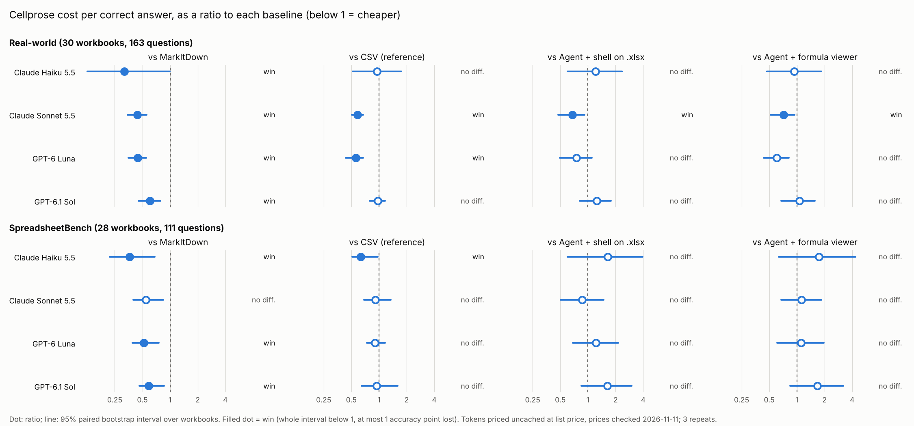

# Cellprose benchmark results

Run on 11 Nov 2026 under [docs/PROTOCOL.md](../docs/PROTOCOL.md). The protocol, code and data were frozen before the first call, and the digest was posted publicly the same day: [gist](https://gist.github.com/Utkarsh-Gaikwad/216cc9dc28d31f4cf616f44e77324c82), `5239114b960aa3327d7f61db1209886a947ebdaaae90659951bfe19c7a1ce9b2` over 146 files. `python3 freeze.py` recomputes it.

**Question.** Does the Cellprose text format let a model answer questions about a spreadsheet correctly for less money than the tools a user would otherwise reach for?

**Metric.** Cost per correct answer per model, with every token priced as uncached input or output at list price. A *win* needs the whole 95% paired-bootstrap interval of the ratio (Cellprose ÷ baseline) below 1 and no more than 1 point of accuracy lost. A *loss* needs the whole interval above 1. Anything else is *no difference*.

## Summary



| | MarkItDown | CSV (reference) | Agent + shell on `.xlsx` | Agent + formula viewer |
|---|---|---|---|---|
| **Real-world** (30 workbooks, 163 questions) | win for all 4 models | win: Sonnet, Luna; no difference: Haiku, Sol | win: Sonnet; no difference: Haiku, Luna, Sol | win: Sonnet; no difference: Haiku, Luna, Sol |
| **SpreadsheetBench** (28 workbooks, 111 questions) | win: Haiku, Luna, Sol; no difference: Sonnet | win: Haiku; no difference: Sonnet, Luna, Sol | no difference for all 4 | no difference for all 4 |

No comparison is a loss.

- **Against MarkItDown**, the format a user would paste into a prompt, Cellprose wins in 7 of 8 model-and-corpus pairs. It costs 0.32–0.60 times as much per correct answer, because accuracy is higher and fewer tokens are sent. In the eighth pair (Sonnet on SpreadsheetBench), the interval is below 1 (0.40–0.85), but accuracy is 1.1 points lower, which the protocol's 1-point rule counts as no difference.
- **On the real-world set, one-shot accuracy with Cellprose** is 93.8–99.3%, against 65.9–84.1% with CSV and 70.0–85.7% with MarkItDown. Most of the gap is in trace, impact and hardcode questions, which depend on formulas that CSV and MarkItDown do not carry.
- **Against an agent that opens the `.xlsx` with a shell** (with or without the formula viewer), 14 of the 16 comparisons are no difference. The two wins are Sonnet on the real-world set, where Cellprose in the prompt costs 0.68 times as much as the shell agent and 0.72 times as much as the viewer agent per correct answer, at equal or higher accuracy. GPT-6 Luna on the real-world set has a ratio interval wholly below 1 against the viewer agent (0.43–0.82), but it is 3.3 accuracy points less accurate, so the verdict is no difference. Haiku on SpreadsheetBench is 4–5 points more accurate in the prompt than as an agent, but its cost intervals are wide (0.60–4.36).
- **On SpreadsheetBench**, CSV already scores 83.5–99.7%: these are value questions with no formula to trace. The format has less to add there, and only Haiku shows a win over CSV.

Limitations are listed at the end and apply to every number above.

**Addendum A** ([below](#addendum-a-cellprose-with-its-own-tools)), frozen and posted separately, tests the agent built for Cellprose (index in the prompt, Cellprose's own tools, no shell) against the same two agents. It costs 0.29–0.79 times as much per correct answer, wins 14 of 24 comparisons, and has no losses. Every remaining "no difference" comes from accuracy, not cost, except one whose interval reaches 1.03.

## Method

- **Arms.** `cellprose_v03` (the v0.3 writer, in the prompt), `markitdown` (in the prompt), `agent_xlsx` (an agent with a shell and the `.xlsx` file), `agent_xlsx_viewer` (the same agent with a formula viewer), `csv` (reference) and `none` (no workbook, a guess control). `agent_cellprose_v03` (the agent given the Cellprose file) is reported beside them.
- **Models**, with prices per million tokens (input / output), checked against the vendors' pricing pages on 2026-11-11:

| Model | ID | Price (input / output) | Long-prompt price |
|---|---|---|---|
| Claude Haiku 5.5 | `claude-haiku-5-5` | $0.10 / $0.50 | $0.50 / $2.50 above 100,000 input tokens |
| Claude Sonnet 5.5 | `claude-sonnet-5-5` | $2.00 / $10.00 | n/a |
| GPT-6 Luna | `gpt-6-luna` | $0.10 / $0.50 | $0.20 / $0.75 above 272,000 input tokens |
| GPT-6.1 Sol | `gpt-6.1-sol` | $2.00 / $10.00 | $4.00 / $15.00 above 272,000 input tokens |

- **Data.** Real-world: 30 workbooks (15 Damodaran, 15 Enron) and 163 rule-generated questions of five types (lookup, address, trace, impact, hardcode). SpreadsheetBench: 28 workbooks and 111 value questions. The two corpora are reported separately and never pooled.
- **Repeats.** 3 for every model and arm, including `none`.
- **Statistics.** Paired bootstrap over workbooks (10,000 resamples, seed 20261009). Repeats are averaged within a workbook first. Verdict accuracies are workbook-averaged; the arm tables below are question-averaged, so the two can differ by a tenth of a point.
- **Runs.** Code at commit `716af38`, clean tree, `--final`.

| Corpus | Invocation | Run id | Resumes |
|---|---|---|---|
| Real-world | one-shot | `20261111T134446Z-4cc39c` | 2 (15:51 and 16:04 UTC) |
| Real-world | agent | `20261111T155116Z-3bb128` | none |
| SpreadsheetBench | one-shot | `20261111T134436Z-a8bd02` | none |
| SpreadsheetBench | agent | `20261111T143900Z-6f34b0` | 1 (15:31 UTC) |

## Results

### Real-world: verdicts

| Model | Baseline | Accuracy (Cellprose / baseline) | Cost per correct, ratio [95% interval] | Verdict |
|---|---|---|---|---|
| Claude Haiku 5.5 | MarkItDown | 96.5% / 70.0% | 0.32 [0.13, 1.00] | win |
| Claude Haiku 5.5 | CSV | 96.5% / 65.9% | 0.95 [0.52, 1.76] | no difference |
| Claude Haiku 5.5 | Agent + shell | 96.5% / 97.0% | 1.21 [0.60, 2.34] | no difference |
| Claude Haiku 5.5 | Agent + viewer | 96.5% / 97.3% | 0.94 [0.47, 1.85] | no difference |
| Claude Sonnet 5.5 | MarkItDown | 99.2% / 81.1% | 0.44 [0.34, 0.55] | win |
| Claude Sonnet 5.5 | CSV | 99.2% / 82.6% | 0.58 [0.50, 0.67] | win |
| Claude Sonnet 5.5 | Agent + shell | 99.2% / 98.8% | 0.68 [0.47, 0.92] | win |
| Claude Sonnet 5.5 | Agent + viewer | 99.2% / 97.4% | 0.72 [0.52, 0.95] | win |
| GPT-6 Luna | MarkItDown | 93.8% / 73.9% | 0.45 [0.35, 0.55] | win |
| GPT-6 Luna | CSV | 93.8% / 73.3% | 0.56 [0.44, 0.68] | win |
| GPT-6 Luna | Agent + shell | 93.8% / 97.6% | 0.75 [0.49, 1.10] | no difference |
| GPT-6 Luna | Agent + viewer | 93.8% / 97.2% | 0.60 [0.43, 0.82] | no difference |
| GPT-6.1 Sol | MarkItDown | 99.3% / 85.7% | 0.60 [0.45, 0.79] | win |
| GPT-6.1 Sol | CSV | 99.3% / 84.1% | 0.97 [0.79, 1.17] | no difference |
| GPT-6.1 Sol | Agent + shell | 99.3% / 99.2% | 1.25 [0.81, 1.78] | no difference |
| GPT-6.1 Sol | Agent + viewer | 99.3% / 99.3% | 1.07 [0.67, 1.57] | no difference |

### Real-world: every arm (mean per call; 3 repeats)

| Model | Arm | Accuracy | Tokens per call | Cost per call | Cost per correct answer | Turns |
|---|---|---|---|---|---|---|
| Claude Haiku 5.5 | `cellprose_v03` | 96.5% | 25,577 | $0.0051 | $0.0053 | 1.0 |
| Claude Haiku 5.5 | `markitdown` | 70.6% | 35,648 | $0.0117 | $0.0165 | 1.0 |
| Claude Haiku 5.5 | `csv` | 66.7% | 21,736 | $0.0037 | $0.0055 | 1.0 |
| Claude Haiku 5.5 | `agent_xlsx` | 96.9% | 32,746 | $0.0043 | $0.0044 | 4.2 |
| Claude Haiku 5.5 | `agent_xlsx_viewer` | 97.2% | 45,927 | $0.0055 | $0.0057 | 4.2 |
| Claude Haiku 5.5 | `agent_cellprose_v03` | 96.9% | 47,320 | $0.0061 | $0.0063 | 4.5 |
| Claude Haiku 5.5 | `none` | 15.9% | 845 | $0.0002 | n/a | 1.0 |
| Claude Sonnet 5.5 | `cellprose_v03` | 99.3% | 24,388 | $0.0563 | $0.0567 | 1.0 |
| Claude Sonnet 5.5 | `markitdown` | 81.4% | 36,155 | $0.1047 | $0.1286 | 1.0 |
| Claude Sonnet 5.5 | `csv` | 82.7% | 22,396 | $0.0804 | $0.0972 | 1.0 |
| Claude Sonnet 5.5 | `agent_xlsx` | 98.7% | 35,175 | $0.0830 | $0.0841 | 4.6 |
| Claude Sonnet 5.5 | `agent_xlsx_viewer` | 97.3% | 33,170 | $0.0771 | $0.0792 | 4.7 |
| Claude Sonnet 5.5 | `agent_cellprose_v03` | 98.3% | 37,671 | $0.0865 | $0.0880 | 4.7 |
| Claude Sonnet 5.5 | `none` | 23.2% | 683 | $0.0024 | n/a | 1.0 |
| GPT-6 Luna | `cellprose_v03` | 93.8% | 20,375 | $0.0026 | $0.0028 | 1.0 |
| GPT-6 Luna | `markitdown` | 74.1% | 28,548 | $0.0046 | $0.0062 | 1.0 |
| GPT-6 Luna | `csv` | 73.3% | 16,743 | $0.0036 | $0.0049 | 1.0 |
| GPT-6 Luna | `agent_xlsx` | 97.5% | 28,446 | $0.0036 | $0.0037 | 4.5 |
| GPT-6 Luna | `agent_xlsx_viewer` | 97.1% | 38,475 | $0.0044 | $0.0046 | 4.2 |
| GPT-6 Luna | `agent_cellprose_v03` | 94.1% | 37,776 | $0.0044 | $0.0047 | 5.0 |
| GPT-6 Luna | `none` | 13.1% | 1,559 | $0.0006 | n/a | 1.0 |
| GPT-6.1 Sol | `cellprose_v03` | 99.3% | 19,378 | $0.0419 | $0.0421 | 1.0 |
| GPT-6.1 Sol | `markitdown` | 86.1% | 25,395 | $0.0599 | $0.0695 | 1.0 |
| GPT-6.1 Sol | `csv` | 84.3% | 13,151 | $0.0364 | $0.0431 | 1.0 |
| GPT-6.1 Sol | `agent_xlsx` | 99.2% | 14,248 | $0.0336 | $0.0338 | 3.5 |
| GPT-6.1 Sol | `agent_xlsx_viewer` | 99.2% | 17,240 | $0.0391 | $0.0394 | 3.5 |
| GPT-6.1 Sol | `agent_cellprose_v03` | 99.0% | 19,102 | $0.0422 | $0.0426 | 3.9 |
| GPT-6.1 Sol | `none` | 2.5% | 490 | $0.0021 | n/a | 1.0 |

### Real-world: accuracy by question type (%)

| Model | Arm | lookup | address | trace | impact | hardcode |
|---|---|---|---|---|---|---|
| Claude Haiku 5.5 | `cellprose_v03` | 100.0 | 98.4 | 96.7 | 88.8 | 99.4 |
| Claude Haiku 5.5 | `markitdown` | 100.0 | 88.9 | 68.7 | 48.9 | 60.2 |
| Claude Haiku 5.5 | `csv` | 100.0 | 84.1 | 60.3 | 45.3 | 62.6 |
| Claude Haiku 5.5 | `agent_xlsx` | 100.0 | 98.4 | 100.0 | 83.8 | 100.0 |
| Claude Haiku 5.5 | `agent_xlsx_viewer` | 100.0 | 98.4 | 100.0 | 85.3 | 100.0 |
| Claude Haiku 5.5 | `agent_cellprose_v03` | 100.0 | 93.7 | 98.8 | 90.4 | 99.4 |
| Claude Haiku 5.5 | `none` | 4.3 | 3.2 | 19.6 | 4.0 | 37.8 |
| Claude Sonnet 5.5 | `cellprose_v03` | 100.0 | 100.0 | 100.0 | 95.8 | 100.0 |
| Claude Sonnet 5.5 | `markitdown` | 100.0 | 95.2 | 83.9 | 71.4 | 62.0 |
| Claude Sonnet 5.5 | `csv` | 98.6 | 96.8 | 82.1 | 74.0 | 70.4 |
| Claude Sonnet 5.5 | `agent_xlsx` | 100.0 | 100.0 | 100.0 | 93.0 | 100.0 |
| Claude Sonnet 5.5 | `agent_xlsx_viewer` | 100.0 | 96.8 | 99.9 | 87.8 | 99.6 |
| Claude Sonnet 5.5 | `agent_cellprose_v03` | 98.6 | 100.0 | 97.9 | 95.8 | 100.0 |
| Claude Sonnet 5.5 | `none` | 4.3 | 4.8 | 32.9 | 6.7 | 47.2 |
| GPT-6 Luna | `cellprose_v03` | 97.1 | 100.0 | 93.3 | 92.0 | 89.6 |
| GPT-6 Luna | `markitdown` | 98.6 | 82.5 | 75.5 | 61.7 | 58.7 |
| GPT-6 Luna | `csv` | 95.7 | 74.6 | 74.8 | 61.7 | 63.6 |
| GPT-6 Luna | `agent_xlsx` | 100.0 | 98.4 | 99.3 | 89.0 | 99.9 |
| GPT-6 Luna | `agent_xlsx_viewer` | 100.0 | 100.0 | 98.3 | 87.2 | 100.0 |
| GPT-6 Luna | `agent_cellprose_v03` | 100.0 | 93.7 | 95.1 | 87.4 | 94.3 |
| GPT-6 Luna | `none` | 1.4 | 1.6 | 16.9 | 2.7 | 32.7 |
| GPT-6.1 Sol | `cellprose_v03` | 100.0 | 100.0 | 100.0 | 96.1 | 100.0 |
| GPT-6.1 Sol | `markitdown` | 100.0 | 98.4 | 86.4 | 81.4 | 70.7 |
| GPT-6.1 Sol | `csv` | 100.0 | 93.7 | 85.4 | 80.0 | 67.6 |
| GPT-6.1 Sol | `agent_xlsx` | 100.0 | 100.0 | 100.0 | 95.6 | 100.0 |
| GPT-6.1 Sol | `agent_xlsx_viewer` | 100.0 | 100.0 | 100.0 | 95.7 | 100.0 |
| GPT-6.1 Sol | `agent_cellprose_v03` | 100.0 | 100.0 | 100.0 | 94.5 | 100.0 |
| GPT-6.1 Sol | `none` | 0.0 | 0.0 | 0.0 | 0.0 | 13.3 |

### SpreadsheetBench: verdicts

| Model | Baseline | Accuracy (Cellprose / baseline) | Cost per correct, ratio [95% interval] | Verdict |
|---|---|---|---|---|
| Claude Haiku 5.5 | MarkItDown | 99.0% / 87.4% | 0.36 [0.22, 0.68] | win |
| Claude Haiku 5.5 | CSV | 99.0% / 82.4% | 0.64 [0.51, 0.97] | win |
| Claude Haiku 5.5 | Agent + shell | 99.0% / 95.0% | 1.64 [0.60, 3.96] | no difference |
| Claude Haiku 5.5 | Agent + viewer | 99.0% / 93.6% | 1.75 [0.63, 4.36] | no difference |
| Claude Sonnet 5.5 | MarkItDown | 96.5% / 97.6% | 0.54 [0.40, 0.85] | no difference |
| Claude Sonnet 5.5 | CSV | 96.5% / 98.8% | 0.91 [0.69, 1.35] | no difference |
| Claude Sonnet 5.5 | Agent + shell | 96.5% / 100.0% | 0.87 [0.50, 1.48] | no difference |
| Claude Sonnet 5.5 | Agent + viewer | 96.5% / 98.1% | 1.12 [0.67, 1.84] | no difference |
| GPT-6 Luna | MarkItDown | 92.9% / 76.9% | 0.52 [0.39, 0.75] | win |
| GPT-6 Luna | CSV | 92.9% / 85.1% | 0.90 [0.74, 1.17] | no difference |
| GPT-6 Luna | Agent + shell | 92.9% / 96.2% | 1.22 [0.69, 2.14] | no difference |
| GPT-6 Luna | Agent + viewer | 92.9% / 96.0% | 1.11 [0.61, 1.96] | no difference |
| GPT-6.1 Sol | MarkItDown | 100.0% / 100.0% | 0.59 [0.46, 0.86] | win |
| GPT-6.1 Sol | CSV | 100.0% / 99.8% | 0.94 [0.65, 1.61] | no difference |
| GPT-6.1 Sol | Agent + shell | 100.0% / 100.0% | 1.63 [0.85, 3.01] | no difference |
| GPT-6.1 Sol | Agent + viewer | 100.0% / 100.0% | 1.68 [0.84, 3.21] | no difference |

### SpreadsheetBench: every arm (mean per call; 3 repeats)

| Model | Arm | Accuracy | Tokens per call | Cost per call | Cost per correct answer | Turns |
|---|---|---|---|---|---|---|
| Claude Haiku 5.5 | `cellprose_v03` | 98.8% | 19,208 | $0.0046 | $0.0047 | 1.0 |
| Claude Haiku 5.5 | `markitdown` | 87.7% | 32,277 | $0.0113 | $0.0128 | 1.0 |
| Claude Haiku 5.5 | `csv` | 83.5% | 17,906 | $0.0061 | $0.0073 | 1.0 |
| Claude Haiku 5.5 | `agent_xlsx` | 97.3% | 21,815 | $0.0027 | $0.0028 | 3.0 |
| Claude Haiku 5.5 | `agent_xlsx_viewer` | 95.8% | 20,178 | $0.0025 | $0.0026 | 2.9 |
| Claude Haiku 5.5 | `agent_cellprose_v03` | 95.2% | 19,292 | $0.0026 | $0.0028 | 3.2 |
| Claude Haiku 5.5 | `none` | 22.5% | 756 | $0.0001 | n/a | 1.0 |
| Claude Sonnet 5.5 | `cellprose_v03` | 95.8% | 18,084 | $0.0421 | $0.0439 | 1.0 |
| Claude Sonnet 5.5 | `markitdown` | 97.0% | 30,728 | $0.0784 | $0.0809 | 1.0 |
| Claude Sonnet 5.5 | `csv` | 98.5% | 16,294 | $0.0471 | $0.0478 | 1.0 |
| Claude Sonnet 5.5 | `agent_xlsx` | 100.0% | 21,849 | $0.0503 | $0.0503 | 3.6 |
| Claude Sonnet 5.5 | `agent_xlsx_viewer` | 97.6% | 16,474 | $0.0382 | $0.0392 | 3.7 |
| Claude Sonnet 5.5 | `agent_cellprose_v03` | 98.8% | 13,505 | $0.0323 | $0.0327 | 3.3 |
| Claude Sonnet 5.5 | `none` | 19.2% | 709 | $0.0022 | n/a | 1.0 |
| GPT-6 Luna | `cellprose_v03` | 93.4% | 15,302 | $0.0018 | $0.0019 | 1.0 |
| GPT-6 Luna | `markitdown` | 76.9% | 23,192 | $0.0029 | $0.0037 | 1.0 |
| GPT-6 Luna | `csv` | 83.8% | 12,268 | $0.0018 | $0.0022 | 1.0 |
| GPT-6 Luna | `agent_xlsx` | 96.4% | 12,090 | $0.0015 | $0.0016 | 3.4 |
| GPT-6 Luna | `agent_xlsx_viewer` | 98.5% | 14,426 | $0.0017 | $0.0017 | 3.4 |
| GPT-6 Luna | `agent_cellprose_v03` | 94.6% | 13,602 | $0.0017 | $0.0018 | 3.4 |
| GPT-6 Luna | `none` | 10.2% | 788 | $0.0002 | n/a | 1.0 |
| GPT-6.1 Sol | `cellprose_v03` | 100.0% | 14,842 | $0.0316 | $0.0316 | 1.0 |
| GPT-6.1 Sol | `markitdown` | 100.0% | 22,828 | $0.0540 | $0.0540 | 1.0 |
| GPT-6.1 Sol | `csv` | 99.7% | 11,929 | $0.0335 | $0.0336 | 1.0 |
| GPT-6.1 Sol | `agent_xlsx` | 100.0% | 8,811 | $0.0194 | $0.0194 | 2.7 |
| GPT-6.1 Sol | `agent_xlsx_viewer` | 100.0% | 8,725 | $0.0189 | $0.0189 | 3.0 |
| GPT-6.1 Sol | `agent_cellprose_v03` | 100.0% | 8,044 | $0.0172 | $0.0172 | 2.8 |
| GPT-6.1 Sol | `none` | 0.0% | 487 | $0.0015 | n/a | 1.0 |

## The `none` control

Accuracy with no workbook at all (a guess), per model:

| Model | Real-world | SpreadsheetBench |
|---|---|---|
| Claude Haiku 5.5 | 15.9% | 22.5% |
| Claude Sonnet 5.5 | 23.2% | 19.2% |
| GPT-6 Luna | 13.1% | 10.2% |
| GPT-6.1 Sol | 2.5% | 0.0% |

Most correct guesses on the real-world set are hardcode questions whose answer is "none" (32.7–47.2% for three of the models), plus some trace questions, where a formula's inputs can be guessed from the wording. Every other arm's accuracy should be read against these figures.

## Failures

A failure is the model's own: the call is recorded, scores 0 on every question, and its tokens count toward cost. There were five, all truncated at `max_tokens` = 32,000:

| Corpus | Model | Arm | Calls |
|---|---|---|---|
| Real-world | Claude Sonnet 5.5 | `csv` | 1 (`rw2_enron_phillip_allen`, repeat 3) |
| SpreadsheetBench | Claude Haiku 5.5 | `markitdown` | 2 (`sb_48921`) |
| SpreadsheetBench | Claude Haiku 5.5 | `csv` | 1 (`sb_48921`) |
| SpreadsheetBench | Claude Sonnet 5.5 | `markitdown` | 1 (`sb_48921`) |

No Cellprose call failed.

## Infrastructure interruptions and resumes

Infrastructure failures are not recorded. The calls stay to do and are made on resume under the same run id, as in PROTOCOL.md section 5.7. All resumes ran on the same commit, settings and inputs, within five hours of the start.

- **Anthropic credit ran out** during the SpreadsheetBench agent invocation. 10 calls failed with a credit error, and after 5 in a row the runner stopped sending to Anthropic, leaving 224 calls to do. After the credit was topped up, the invocation was resumed at 15:31 UTC, and all 224 calls were recorded.
- **OpenAI credit ran out** at the end of the real-world one-shot invocation. 8 calls failed with a credit error, leaving 44 GPT-6.1 Sol calls to do. After the credit was topped up, they were made on resume at 16:04 UTC.
- **The real-world one-shot process was stopped** by the 2-hour limit on a background job in the session running the benchmark, after 1,396 of its 1,440 calls were recorded. It was resumed at 15:51 UTC. The calls in flight when it stopped were neither recorded nor logged; they were made again on resume, and whatever they spent is outside both the metric and the infrastructure log.

Spend on the logged infrastructure failures, which is outside the metric: $0.07 (Anthropic) and $0.00 (OpenAI).

None of this changes the protocol: no arm, model, workbook, question, setting or price changed, and no recorded call was redone.

## Spend

| Corpus | Model | List price, uncached (the metric) | Billed |
|---|---|---|---|
| Real-world | Claude Haiku 5.5 | $3.29 | $2.74 |
| Real-world | Claude Sonnet 5.5 | $44.13 | $33.70 |
| Real-world | GPT-6 Luna | $2.15 | $1.62 |
| Real-world | GPT-6.1 Sol | $22.95 | $19.03 |
| SpreadsheetBench | Claude Haiku 5.5 | $2.52 | $2.36 |
| SpreadsheetBench | Claude Sonnet 5.5 | $24.42 | $20.70 |
| SpreadsheetBench | GPT-6 Luna | $0.98 | $0.84 |
| SpreadsheetBench | GPT-6.1 Sol | $14.78 | $13.23 |
| **Total** | | **$115.22** | **$94.22** |

"Billed" counts the Anthropic prompt cache on agent turns. OpenAI's automatic cached-input discount is not applied, so the real OpenAI bill may be lower. The preflight, which is not scored, cost $0.28.

## Limitations

- **Test-set size:** 30 real-world workbooks with 163 questions, and 28 SpreadsheetBench workbooks with 111 questions, 3 repeats each. The interval resamples workbooks, so it is wide when they are few (Haiku's intervals are the widest). The two corpora are never pooled.
- **Prices:** list prices from `runner/models.py`, as frozen, matched the vendors' pricing pages on 2026-11-11. Every token is priced as uncached input or output, and the billed amount is shown beside the metric, never in its place. Percentages depend on the input-to-output price ratio; dollars depend on the prices too.
- **One-shot against agent:** a one-shot call and an agent loop spend tokens differently, because the loop re-reads a growing context every turn. A win over an agent is on cost per correct answer, which is what a user pays. It says nothing about which reads a workbook better at equal cost.
- **Tokenizers:** Claude and GPT count the same text differently. The Cellprose prompt was 1.31× the CSV prompt on Claude and 1.60× on GPT. Savings therefore differ by model; results are per model and nothing is pooled.
- **Models and date:** four models, run on one date. Some model IDs have no dated snapshot. Nothing is claimed for a model that was not run.
- **Question generation:** the real-world questions are generated by rule from the workbooks (`external/realworld2.py`), and the SpreadsheetBench questions restate that benchmark's tasks as value questions (`external/spreadsheetbench.py`). Neither set was written by the workbooks' authors.

## Reproducing

```bash
python3 freeze.py                                      # digest 5239114b…a1ce9b2
CELLPROSE_CORPUS=external/realworld2 RESULTS_DIR=results/run_rw2 python3 score.py && \
  CELLPROSE_CORPUS=external/realworld2 RESULTS_DIR=results/run_rw2 python3 analyze.py
CELLPROSE_CORPUS=external/spreadsheetbench RESULTS_DIR=results/run_sb python3 score.py && \
  CELLPROSE_CORPUS=external/spreadsheetbench RESULTS_DIR=results/run_sb python3 analyze.py
python3 plot_results.py results/run_rw2 results/run_sb ../docs/img/benchmark-run.png
```

- **Real-world:** the raw responses are in `results/run_rw2/raw/`, with the run manifests in `results/run_rw2/runs/` and the analysis output in `results/run_rw2/analysis.txt`.
- **SpreadsheetBench:** the inputs are under a share-alike licence, so the raw responses are not committed. Their SHA-256 checksums are in `results/run_sb/raw_sha256.txt`, beside the run manifests, verdicts, summary and analysis output.

---

## Addendum A: Cellprose with its own tools

Run on 11 Nov 2026 under [docs/PROTOCOL_ADDENDUM.md](../docs/PROTOCOL_ADDENDUM.md). It was frozen and its digest posted before the first call: [gist](https://gist.github.com/Utkarsh-Gaikwad/a6c433049f69434ede8e4d51a08f4e84), `17a8011250d9888ee994e513f8a829035d79af240d92e241fe110726b8afe62c` over 150 files. `python3 freeze_addendum.py` recomputes it.

**Why it exists.** The benchmark run above measured Cellprose sent once in the prompt, and as a file read with the shell agent's tools. It did not include the agent setup built for Cellprose in development (E34): the workbook's index in the first message, then Cellprose's `read_range`, `find`, `trace` and `whatif` tools, with no shell (`agent_cellprose_lean`). **The decision to run this addendum was made after the benchmark run's results were seen.** The arm was built and tested on development data before the benchmark run, and its code is unchanged since. This is the last new arm tested on these held-out workbooks.

**Setup.** `agent_cellprose_lean` against `agent_xlsx` and `agent_xlsx_viewer`. All three arms ran in one session, from commit `5a65e14` with a clean tree. The models, data, turn limit and per-call cap are the same as in the benchmark run, with 2 repeats. Run ids: `20261111T180131Z-242737` (real-world) and `20261111T180131Z-8974b0` (SpreadsheetBench), with no resumes. No result of the benchmark run is compared with a result of this addendum.

### Summary

| | vs Agent + shell on `.xlsx` | vs Agent + formula viewer |
|---|---|---|
| **Real-world, primary** (impact questions left out) | win: Sonnet, Sol; no difference: Haiku, Luna | win: Sonnet, Sol; no difference: Haiku, Luna |
| **Real-world, all questions** | win: Luna, Sol; no difference: Haiku, Sonnet | win: Luna, Sol; no difference: Haiku, Sonnet |
| **SpreadsheetBench** | win for all 4 models | win: Haiku, Sol; no difference: Sonnet, Luna |

No comparison is a loss.

- **Cost.** With its own tools, Cellprose costs 0.29–0.79 times as much per correct answer as the agents reading the `.xlsx`. In 23 of the 24 comparisons, the whole interval is below 1. The saving comes from fewer turns (2.2–3.2 per call, against 2.6–4.9) and from the index replacing the turn an agent spends exploring the file.
- **Accuracy is what holds back the remaining "no difference" verdicts.** Haiku and Luna on the real-world primary view cost a third to a half as much, but are 1.0–2.6 points less accurate, beyond the protocol's 1-point allowance. The weak spot is address questions (90.5% for both, against 97.6–100% for the agents). Sonnet on the all-questions view is 1.3–1.6 points less accurate, mostly on impact questions (84.8%, against 89.6–92.1%). On SpreadsheetBench, Luna against the viewer agent is 3.6 points less accurate. Sonnet against the viewer agent has an interval that reaches 1.03.
- **The `whatif` caveat.** For GPT-6.1 Sol and GPT-6 Luna, `whatif` lifted impact accuracy to 100%. That's why the protocol makes the impact-free view primary. In that view Sol still wins against both agents, and Luna's cost ratio stays at 0.29–0.37, with accuracy as its only shortfall.

#### Real-world, primary verdict (impact questions left out of accuracy)

| Model | Baseline | Accuracy (lean / baseline) | Cost per correct, ratio [95% interval] | Verdict |
|---|---|---|---|---|
| Claude Haiku 5.5 | Agent + shell | 97.4% / 99.7% | 0.51 [0.39, 0.70] | no difference |
| Claude Haiku 5.5 | Agent + viewer | 97.4% / 100.0% | 0.46 [0.35, 0.62] | no difference |
| Claude Sonnet 5.5 | Agent + shell | 99.5% / 99.8% | 0.49 [0.35, 0.67] | win |
| Claude Sonnet 5.5 | Agent + viewer | 99.5% / 99.9% | 0.50 [0.35, 0.71] | win |
| GPT-6 Luna | Agent + shell | 97.7% / 98.7% | 0.37 [0.27, 0.50] | no difference |
| GPT-6 Luna | Agent + viewer | 97.7% / 99.9% | 0.29 [0.22, 0.38] | no difference |
| GPT-6.1 Sol | Agent + shell | 100.0% / 100.0% | 0.42 [0.33, 0.53] | win |
| GPT-6.1 Sol | Agent + viewer | 100.0% / 100.0% | 0.39 [0.31, 0.48] | win |

#### Real-world, secondary verdict (all questions)

| Model | Baseline | Accuracy (lean / baseline) | Cost per correct, ratio [95% interval] | Verdict |
|---|---|---|---|---|
| Claude Haiku 5.5 | Agent + shell | 95.3% / 97.3% | 0.51 [0.39, 0.69] | no difference |
| Claude Haiku 5.5 | Agent + viewer | 95.3% / 97.2% | 0.46 [0.35, 0.62] | no difference |
| Claude Sonnet 5.5 | Agent + shell | 96.9% / 98.4% | 0.50 [0.36, 0.67] | no difference |
| Claude Sonnet 5.5 | Agent + viewer | 96.9% / 98.1% | 0.51 [0.35, 0.72] | no difference |
| GPT-6 Luna | Agent + shell | 98.1% / 96.4% | 0.36 [0.26, 0.49] | win |
| GPT-6 Luna | Agent + viewer | 98.1% / 98.9% | 0.29 [0.22, 0.38] | win |
| GPT-6.1 Sol | Agent + shell | 100.0% / 99.2% | 0.42 [0.32, 0.52] | win |
| GPT-6.1 Sol | Agent + viewer | 100.0% / 99.3% | 0.38 [0.31, 0.47] | win |

#### Real-world: every arm (mean per call; 2 repeats; all questions)

| Model | Arm | Accuracy | Tokens per call | Cost per call | Cost per correct answer | Turns |
|---|---|---|---|---|---|---|
| Claude Haiku 5.5 | `agent_cellprose_lean` | 95.2% | 17,214 | $0.0024 | $0.0025 | 3.0 |
| Claude Haiku 5.5 | `agent_xlsx` | 97.3% | 36,888 | $0.0047 | $0.0048 | 4.3 |
| Claude Haiku 5.5 | `agent_xlsx_viewer` | 97.2% | 43,053 | $0.0053 | $0.0054 | 4.2 |
| Claude Sonnet 5.5 | `agent_cellprose_lean` | 96.9% | 17,880 | $0.0421 | $0.0434 | 3.2 |
| Claude Sonnet 5.5 | `agent_xlsx` | 98.4% | 36,099 | $0.0857 | $0.0871 | 4.7 |
| Claude Sonnet 5.5 | `agent_xlsx_viewer` | 98.1% | 36,467 | $0.0843 | $0.0859 | 4.9 |
| GPT-6 Luna | `agent_cellprose_lean` | 97.9% | 10,983 | $0.0013 | $0.0013 | 2.6 |
| GPT-6 Luna | `agent_xlsx` | 96.5% | 28,052 | $0.0035 | $0.0037 | 4.6 |
| GPT-6 Luna | `agent_xlsx_viewer` | 98.9% | 39,003 | $0.0045 | $0.0046 | 4.3 |
| GPT-6.1 Sol | `agent_cellprose_lean` | 100.0% | 6,197 | $0.0147 | $0.0147 | 2.5 |
| GPT-6.1 Sol | `agent_xlsx` | 99.2% | 15,004 | $0.0351 | $0.0354 | 3.4 |
| GPT-6.1 Sol | `agent_xlsx_viewer` | 99.2% | 16,767 | $0.0382 | $0.0385 | 3.4 |

#### Real-world: accuracy by question type (%)

| Model | Arm | lookup | address | trace | impact | hardcode |
|---|---|---|---|---|---|---|
| Claude Haiku 5.5 | `agent_cellprose_lean` | 95.7 | 90.5 | 99.1 | 85.4 | 100.0 |
| Claude Haiku 5.5 | `agent_xlsx` | 100.0 | 97.6 | 100.0 | 86.3 | 100.0 |
| Claude Haiku 5.5 | `agent_xlsx_viewer` | 100.0 | 100.0 | 100.0 | 84.3 | 100.0 |
| Claude Sonnet 5.5 | `agent_cellprose_lean` | 100.0 | 97.6 | 99.8 | 84.8 | 100.0 |
| Claude Sonnet 5.5 | `agent_xlsx` | 100.0 | 100.0 | 99.5 | 92.1 | 100.0 |
| Claude Sonnet 5.5 | `agent_xlsx_viewer` | 100.0 | 100.0 | 99.9 | 89.6 | 100.0 |
| GPT-6 Luna | `agent_cellprose_lean` | 100.0 | 90.5 | 98.5 | 100.0 | 98.3 |
| GPT-6 Luna | `agent_xlsx` | 100.0 | 97.6 | 98.1 | 86.1 | 99.9 |
| GPT-6 Luna | `agent_xlsx_viewer` | 100.0 | 100.0 | 99.8 | 94.5 | 100.0 |
| GPT-6.1 Sol | `agent_cellprose_lean` | 100.0 | 100.0 | 100.0 | 100.0 | 100.0 |
| GPT-6.1 Sol | `agent_xlsx` | 100.0 | 100.0 | 100.0 | 95.2 | 100.0 |
| GPT-6.1 Sol | `agent_xlsx_viewer` | 100.0 | 100.0 | 100.0 | 95.7 | 100.0 |

#### SpreadsheetBench verdict (all questions; the set has no impact questions)

| Model | Baseline | Accuracy (lean / baseline) | Cost per correct, ratio [95% interval] | Verdict |
|---|---|---|---|---|
| Claude Haiku 5.5 | Agent + shell | 94.3% / 90.7% | 0.66 [0.49, 0.94] | win |
| Claude Haiku 5.5 | Agent + viewer | 94.3% / 93.8% | 0.68 [0.49, 0.99] | win |
| Claude Sonnet 5.5 | Agent + shell | 99.3% / 100.0% | 0.55 [0.42, 0.74] | win |
| Claude Sonnet 5.5 | Agent + viewer | 99.3% / 99.6% | 0.79 [0.61, 1.03] | no difference |
| GPT-6 Luna | Agent + shell | 95.7% / 94.3% | 0.58 [0.45, 0.76] | win |
| GPT-6 Luna | Agent + viewer | 95.7% / 99.3% | 0.54 [0.39, 0.79] | no difference |
| GPT-6.1 Sol | Agent + shell | 100.0% / 100.0% | 0.61 [0.45, 0.89] | win |
| GPT-6.1 Sol | Agent + viewer | 100.0% / 100.0% | 0.71 [0.53, 0.97] | win |

#### SpreadsheetBench: every arm (mean per call; 2 repeats; all questions)

| Model | Arm | Accuracy | Tokens per call | Cost per call | Cost per correct answer | Turns |
|---|---|---|---|---|---|---|
| Claude Haiku 5.5 | `agent_cellprose_lean` | 94.6% | 10,816 | $0.0018 | $0.0019 | 2.3 |
| Claude Haiku 5.5 | `agent_xlsx` | 93.7% | 21,394 | $0.0027 | $0.0029 | 3.1 |
| Claude Haiku 5.5 | `agent_xlsx_viewer` | 95.9% | 21,975 | $0.0027 | $0.0028 | 3.0 |
| Claude Sonnet 5.5 | `agent_cellprose_lean` | 99.1% | 10,874 | $0.0285 | $0.0288 | 2.6 |
| Claude Sonnet 5.5 | `agent_xlsx` | 100.0% | 22,772 | $0.0524 | $0.0524 | 3.5 |
| Claude Sonnet 5.5 | `agent_xlsx_viewer` | 99.5% | 15,316 | $0.0362 | $0.0364 | 3.8 |
| GPT-6 Luna | `agent_cellprose_lean` | 96.4% | 6,224 | $0.0009 | $0.0009 | 2.2 |
| GPT-6 Luna | `agent_xlsx` | 92.8% | 12,466 | $0.0016 | $0.0017 | 3.3 |
| GPT-6 Luna | `agent_xlsx_viewer` | 99.1% | 15,055 | $0.0017 | $0.0018 | 3.3 |
| GPT-6.1 Sol | `agent_cellprose_lean` | 100.0% | 5,144 | $0.0120 | $0.0120 | 2.2 |
| GPT-6.1 Sol | `agent_xlsx` | 100.0% | 8,851 | $0.0195 | $0.0195 | 2.6 |
| GPT-6.1 Sol | `agent_xlsx_viewer` | 100.0% | 7,785 | $0.0169 | $0.0169 | 2.9 |

### Failures, resumes and spend

- **Failures:** none. Every one of the 1,392 calls was recorded.
- **Infrastructure:** no infrastructure failures and no resumes.
- **Spend:** $29.21 at list price, uncached (the metric), and $17.82 billed:
  - Real-world: $19.30 list, $11.02 billed.
  - SpreadsheetBench: $9.91 list, $6.80 billed.
- **Preflight** (lean arm, 8 calls, not scored): $0.07.

### Limitations of the addendum

The limitations of the benchmark run apply here as well, with 2 repeats instead of 3. Three more apply only to the addendum:

- **It was decided after the benchmark run's results were seen.** The arm was fixed beforehand, on development data, but the choice to test it on held-out data came afterwards.
- **It's a product setup, not a one-variable change.** `agent_cellprose_lean` has a different system prompt and no shell, so it measures an agent equipped with Cellprose's tools against agents equipped with a shell.
- **`whatif` shares its method with the impact ground truth.** That's why the real-world primary verdict leaves impact questions out.

### Reproducing the addendum

```bash
python3 freeze_addendum.py                                     # digest 17a80112…26b8afe62c
export COMPARE_ENC=agent_cellprose_lean
CELLPROSE_CORPUS=external/realworld2 RESULTS_DIR=results/addendum_rw2 python3 score.py
CELLPROSE_CORPUS=external/realworld2 RESULTS_DIR=results/addendum_rw2 python3 analyze.py
python3 addendum_noimpact.py results/addendum_rw2
CELLPROSE_CORPUS=external/realworld2 RESULTS_DIR=results/addendum_rw2_noimpact python3 analyze.py
CELLPROSE_CORPUS=external/spreadsheetbench RESULTS_DIR=results/addendum_sb python3 score.py
CELLPROSE_CORPUS=external/spreadsheetbench RESULTS_DIR=results/addendum_sb python3 analyze.py
```

- **Real-world:** the raw responses are committed in `results/addendum_rw2/raw/`.
- **SpreadsheetBench:** the raw responses aren't committed, because of the share-alike licence. Their checksums are in `results/addendum_sb/raw_sha256.txt`.
