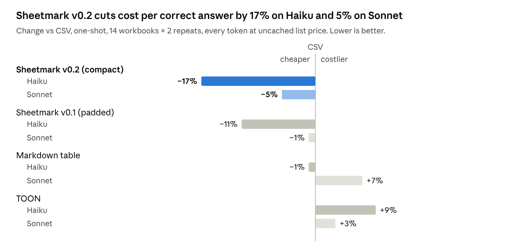

# Cellprose design doc

Oct 7, 2026

> **Status, Nov 2026.** This is the design record. Its benchmark sections measured the **v0.2** text (E09, E16, E17), so they say v0.2 on purpose. The current format is **v0.3** ([SPEC.md](SPEC.md), which wins where the two differ). The latest evidence on v0.3 is the pre-registered 11 Nov 2026 run and its addendum ([RESULTS.md](../benchmarks/RESULTS.md), E36 and E37).

## Summary

Cellprose is a compact, GitHub-renderable Markdown format (v0.3 today; the v0.2 text below is what the early benchmarks measured): a pipe table per region with A1 row and column labels, formulas in a separate block as fill ranges, and formula results rounded to 6 significant figures.

In the E09 runs (Claude CLI, 14 workbooks, two same-session repeats) it cut cost per correct answer against CSV by 17% on Claude Haiku 5.5 and 5% on Claude Sonnet 5.5, rising to 26% and 16% on the hard workbooks, while accuracy went up on both. The direct-API runs (E16, 7 models) point the same way but are smaller on the bigger models: cost is level (−3% to +3%) on Sonnet 5.5, Opus 5.5 and the GPT-6.1 and 6 Astra models, because v0.2 sends 24–27% more input than CSV and the saving on output does not always cover it. Giving an agent the Cellprose file instead of the raw .xlsx cut cost by 19–27%; putting the Cellprose text straight in the prompt cut it by 55–66% (E09, Claude CLI).

> Limits: 14 small synthetic workbooks (largest 150 rows), 2 repeats, one turn per question, Claude models, list prices checked 2026-10-11; savings may differ by tokenizer. Not yet run on real workbooks. Full list: `benchmarks/limitations.py` and the Limitations section below.

The gain comes from less reasoning, not a smaller file: models spend 21–31% fewer output tokens working out what the sheet means. Cellprose is also the only format tested that lets a model tell typed-in numbers from formulas (100% versus 68–75%).

## Benchmark results

On cost per correct answer (all input and output tokens, priced and divided by accuracy), Cellprose v0.2 was cheaper than every other format in the E09 runs, on both Haiku 5.5 and Sonnet 5.5; records-style formats like TOON cost more than CSV. That claim is limited to those two models and that harness. It does not hold as "beats every format on every model":

- **Cheaper on cost per correct answer:** the two Haiku models and `gpt6luna` (−11% to −25% against CSV in E16).
- **Level within spread:** Sonnet 5.5, Opus 5.5, `gpt61sol` and `gpt6astra` (−3% to +3% in E16). Accuracy is equal or higher there, so the case on those models is accuracy and typed-in-versus-formula detection, not price.
- **Input overhead:** v0.2 (`cellprose_lean_gfm`) sends 24–27% more input tokens than CSV. `cellprose_lean`, the layout that is not GitHub-renderable, sends +18% (E17).
- **Competing formats not all tested on every model.** E16 compared CSV only; E17 compared 11 encodings on three cheap models only. The real tools (MarkItDown output, an agent over the .xlsx) are scheduled for the protocol run ([PROTOCOL.md](PROTOCOL.md)).

**Which numbers to cite.** E09 (Claude CLI) and E16/E17 (direct API runner) are different harnesses, invocations and, at the time, price tables. Never compare or pool them (CLAUDE.md, benchmark integrity); cite each with its own run. The headline until the protocol run replaces it is E16/E17 for the API result and E09 for agent mode, each stated with its limits.



The gap widens on the 4 hard workbooks, where logic can't be guessed from values: −26% on Haiku and −16% on Sonnet. The saving comes almost entirely from output: v0.2 adds 13–14% input tokens over CSV (prompt included), but models write 21–31% fewer reasoning and answer tokens.

**Accuracy by task, both models averaged**

| Format | Lookup | Cell address | Formula trace | Impact | Typed-in vs formula |
| --- | --- | --- | --- | --- | --- |
| CSV | 100% | 100% | 99% | 97% | 68% |
| Markdown table | 100% | 100% | 100% | 98% | 74% |
| TOON | 100% | 96% | 91% | 95% | 75% |
| Cellprose v0.1 (padded) | 100% | 100% | 100% | 99% | 100% |
| Cellprose v0.2 (compact) | 100% | 100% | 100% | 97% | 100% |

**Agent mode: file on disk plus shell tools, against the text in the prompt**

| Model | Raw .xlsx with tools | Cellprose file with tools | Cellprose text in prompt |
| --- | --- | --- | --- |
| Haiku 5.5: tokens per task | 24,900 | 16,600 | 8,300 |
| Haiku 5.5: cost per task | $0.0033 | $0.0024 | $0.0015 |
| Haiku 5.5: accuracy | 99.8% | 98.9% | 98.9% |
| Sonnet 5.5: tokens per task | 15,200 | 12,400 | 4,100 |
| Sonnet 5.5: cost per task | $0.036 | $0.028 | $0.012 |
| Sonnet 5.5: accuracy | 99.7% | 98.8% | 99.7% |

All figures are means of two same-session repeats ([experiment E09](../experiments/E09-same-session-repeats.md); every run is logged in [experiments/](../experiments/)). Tokens count everything read and written across all turns; cost prices every input token as uncached, because identical repeated prompts hit the prompt cache and would otherwise look about 90% cheaper.

## Format decisions

Every open question in the v0.1 spec is now settled, each by a measured difference rather than taste.

| Question | Decision | Evidence |
| --- | --- | --- |
| Formulas inline in the grid or in a separate block? | Separate block, with fill ranges | Inline cost Sonnet +47% tokens and dropped its accuracy to 94%; the block is what lets models spot typed-in overrides |
| Column letters or the sheet's own labels in the header row? | Column letters | Labels added tokens (+20% on Sonnet) and gained no accuracy |
| Padded pipe table, compact pipe table, or comma-separated code block? | Compact pipe table (`\|2\|Units\|1200\|`) | Renders on GitHub; with rounding, 24–38% fewer characters than v0.1; only \~4% more than the code block |
| Keep the `Sheet:` prefix on sheet headings? | Keep | Without it, Haiku read `# Report` as a title and invented a sheet named Sheet1 |
| Precision of formula results | 6 significant figures | Results are recomputed from formulas on decode, so no round-trip loss; lookups stayed at 100% |
| Precision of typed-in values | Exact | They are the source data |
| Key-value or TOON style records? | Rejected | They drop row and column positions: address accuracy fell to 43–50% on Haiku |

## Format v0.3 at a glance

The example below is v0.3: v0.2 differed only in the grid, which had an outer pipe on both sides of every row (`|2|Units|1200|`), and in having no `arrays` block. The v0.3 writer drops the outer pipes (E19: accuracy unchanged, billed input −4.5% on Claude and −2.9% on GPT, cost per correct answer not measurably different) and adds array formulas. The benchmark results quoted elsewhere in this file are for the v0.2 text. A v0.3 file is plain Markdown: front matter, a heading per sheet, a heading per region, then the region's grid and its formulas and formats blocks.

````markdown
---
cellprose: 0.3
---

# Sheet: P&L

## A1:F4

#|A|B|C|D|E|F
-|-|-|-|-|-|-
1||Q1|Q2|Q3|Q4|Total
2|Units|1200|1296|1399.68|1511.65|5407.33
3|Price|45|45|45|45
4|Revenue|54000|58320|62985.6|68024.4|243330

```formulas
C2:E2 = B2*(1+Growth)
F2 = SUM(B2:E2)
B3:E3 = Price
B4:E4 = B2*B3
F4 = SUM(B4:E4)
```

```formats
B4:F4 = $#,##0
```

# Names

```names
Growth = Assumptions!$B$2
Price = Assumptions!$B$3
```
````

A gap in a fill range is the tell for a typed-in override: `C2:E2` then `G2:I2` means F2 holds a typed number, which is why both models found every override in Cellprose, while value-only formats scored 56–78% on that task.

## Architecture


Encoding detects rectangular regions, groups identical shifted formulas into fill ranges, and writes everything in a fixed order so one changed cell is one changed line. Parsing reverses it; LibreOffice is only needed when a workbook was saved without cached values.

## Components and interfaces

One Python package, `cellprose`, carries the converter; every other surface is a thin wrapper over its two functions.

| Surface | Interface | Purpose |
| --- | --- | --- |
| Python API | `cellprose.dumps(path, profile="full")` → str; `cellprose.load(text)` → `Workbook`; `Workbook.to_xlsx(path)` | Core library for pipelines |
| CLI | `cellprose encode book.xlsx`, `cellprose decode book.sheet.md`, `cellprose check book.sheet.md` | Batch conversion and CI checks |
| Git diff driver | `*.xlsx diff=cellprose` in `.gitattributes` | Readable diffs of .xlsx files already in a repo |
| Pre-commit hook | Writes a `.sheet.md` beside each committed .xlsx | Workbooks become viewable on GitHub with no workflow change |
| MCP server | `read_workbook(path, sheets?, range?)`, `write_cells(path, edits)` | Agents read Cellprose and write back to .xlsx |
| Agent skill | A short SKILL.md that explains the blocks | Lets agents read the format without a spec lookup |

The git diff driver and pre-commit hook answer the GitHub problem directly: a team keeps its .xlsx files and gains a readable twin and readable diffs.

## Testing and conformance

Every release must pass a byte-identical round trip on the whole test corpus, and the benchmark runs in CI so a format change that costs tokens or accuracy is caught before it ships.

- **Round-trip tests.** For each corpus workbook: encode, decode to .xlsx, recalculate with LibreOffice, encode again; both texts must match byte for byte, and every value must match the original within floating-point tolerance.
- **Golden files.** Each spec example in SPEC.md is a test fixture, so the spec and the code cannot drift.
- **Corpus.** The 14 benchmark workbooks, plus edge cases (merged cells, dates, errors, text that looks like numbers, sheet names with spaces and `#`), plus public real-world workbooks (30 in the 11 Nov 2026 run).
- **Benchmark in CI.** A small sample (one model, 14 workbooks) runs on every pull request that touches the writer; the full run is done before each release and published with it.
- **Conformance kit.** Fixtures and expected output published separately, so writers in other languages can prove they produce the same bytes.

## Roadmap

The order is spec, reader and writer, then the surfaces that put the format in front of people; each step ships on its own.

1. **Spec.** Done for v0.3: the decisions below are folded into SPEC.md, with the conformance kit and golden tests. It is published together with the benchmark repo at release.
2. **Writer (encode).** Production version of the benchmark encoder: region detection, fill ranges, formats, names, compact profile.
3. **Reader (decode).** Text back to .xlsx with values, formulas, formats, merges and names; round-trip tests green on the corpus. Done for the 14 benchmark workbooks and an edge-case set ([E14](../experiments/E14-decoder-roundtrip.md)); public real-world workbooks join the corpus with the wider benchmark.
4. **GitHub workflow.** Git diff driver and pre-commit hook, so .xlsx files in a repo get a readable twin and readable diffs; then an interactive viewer that adds spreadsheet behaviour to rendered `.sheet.md` tables (click a cell for its address and formula, copy ranges as a grid, highlight a formula's inputs).
5. **Agent surfaces.** MCP server and agent skill.
6. **Wider benchmark.** OpenAI and open-weight models, real-world workbooks, larger sheets for the compact profile.
7. **v1.0.** Freeze the spec once two independent writers pass the conformance kit. The second writer (JavaScript, [`js/`](../js/README.md)) passes it; the spec points it left open are listed there and should be settled, with kit cases, before the freeze.

## Limitations and open questions

The results are solid in direction but small in scale: 14 synthetic workbooks, two repeats, Claude models only.

- **Compare like with like.** Haiku 4.5 spent about 5× more reasoning tokens on these prompts than Haiku 5.5, which inflated early savings to 36–56% when runs of the two were compared. Only same-session repeats of one model are reported here. The API runner pins the exact model ID of every call, so Haiku 4.5, Haiku 5.5 and Sonnet 5.5 are reported separately and every format runs in one invocation.
- **Exploratory variants ran once.** The inline-formula and label-header comparisons in Format decisions come from a single run and should be repeated before the spec freezes.
- **Agent mode loses about 1 point of accuracy with the Cellprose file** (98.8–98.9% against 99.7–99.8% for raw .xlsx), on trace and impact questions. Worth a look at how agents read fill ranges.
- **Small, clean workbooks.** The largest has 150 rows. Real models with thousands of rows will test the compact profile and region detection.
- **Claude only.** The numbers above are Haiku 5.5 and Sonnet 5.5; Haiku 4.5 is being added through the pinned API runner. OpenAI and open-weight models follow; savings may differ by tokenizer.
- **Round trip is lossless for what the format carries, no more.** Styles, charts and the like are non-goals. Within the format: number formats are kept for every cell with a value, loose cells included, but a loose cell's format is a separate `formats` block, which the benchmarked text did not have; line breaks read back as LF; array formulas are not supported (the writer warns and writes their cached values); a decoded file has no cached formula values until a spreadsheet app opens it (`cellprose decode --recalc auto` asks LibreOffice, which may rewrite number-format strings such as `yyyy-mm-dd` to `yyyy\-mm\-dd`).
- **Open:** should the compact profile summarise long uniform tables, and at what row count does that beat sending every row?
- **Open:** final name and file extension (`.sheet.md` is the working choice).
