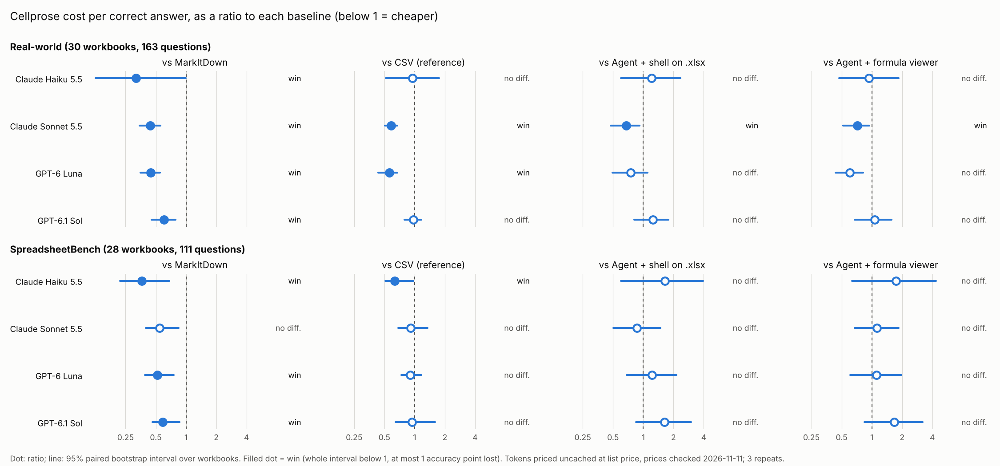
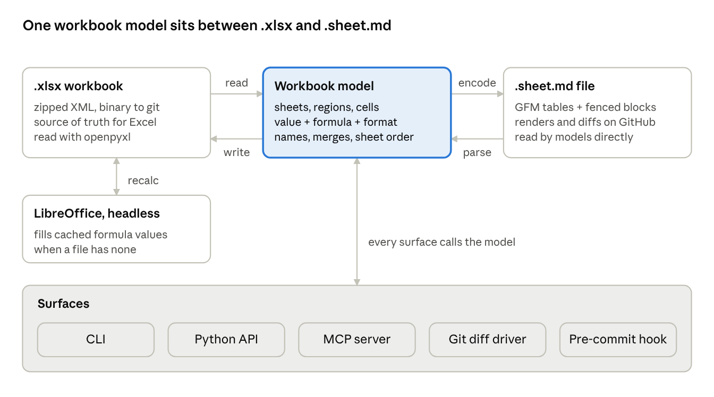

# Cellprose design doc

Oct 7, 2026

> **Status, Nov 2026.** This is the design record for **v0.3**, the current format ([SPEC.md](SPEC.md) wins where the two differ). The benchmark results are the pre-registered 11 Nov 2026 run and its addendum ([RESULTS.md](../benchmarks/RESULTS.md), E36 and E37). The earlier v0.2 results (E09, E16, E17) are kept as history in the last section.

## Summary

Cellprose is a compact, GitHub-renderable Markdown format (v0.3): a pipe table per region with A1 row and column labels, formulas in a separate block as fill ranges, and formula results rounded to 6 significant figures.

On the pre-registered run of 11 Nov 2026 (four models, 3 repeats, public workbooks), sending a workbook once as Cellprose got 93.8–99.3% of real-world questions right, against 65.9–84.1% for CSV and 70.0–85.7% for MarkItDown. It cost 0.32–0.60 times as much per correct answer as MarkItDown (a win on all four models), beat CSV on Sonnet and Luna, and was not measurably different in cost from an agent opening the `.xlsx` with a shell on three of four models (a win on Sonnet, 0.68 times the cost). With Cellprose's own tools, an agent cost 0.29–0.79 times as much as those shell agents and won 14 of 24 comparisons. No comparison in the run is a loss. The gain is in the formula questions (trace, impact, typed-in versus formula); on value-only SpreadsheetBench, CSV already scores 83.5–99.7% and there is little to add.

> Limits: 30 real-world and 28 SpreadsheetBench workbooks, 3 repeats, four models on one date, rule-generated questions, list prices checked 2026-11-11 with every token uncached; nothing pooled across models or corpora.

The full tables are under Benchmark results below. The v0.2 findings that shaped the format (E09, E16, E17) are history, kept in the last section.

## Benchmark results

These are the v0.3 results: the pre-registered run of 11 Nov 2026 ([E36](../experiments/E36-benchmark-run.md)) and its frozen addendum ([E37](../experiments/E37-addendum-lean-tools.md)). The protocol, code and data were frozen and the digest posted publicly before the first call. Every number below is copied from [RESULTS.md](../benchmarks/RESULTS.md), which has the full tables, the method and the limitations.



**Question and metric.** Does the text format let a model answer correctly for less money than the tools a user would otherwise use? The metric is cost per correct answer per model, every token priced as uncached at list price. A *win* needs the whole 95% paired-bootstrap interval of the ratio (Cellprose ÷ baseline) below 1 and at most 1 point of accuracy lost; a *loss* needs the whole interval above 1; anything else is *no difference*.

**Verdicts** (Cellprose in the prompt against each baseline, four models, 3 repeats)

| | MarkItDown | CSV | Agent + shell on `.xlsx` | Agent + formula viewer |
|---|---|---|---|---|
| **Real-world** (30 workbooks, 163 questions) | win for all 4 models | win: Sonnet, Luna; no difference: Haiku, Sol | win: Sonnet; no difference: the rest | win: Sonnet; no difference: the rest |
| **SpreadsheetBench** (28 workbooks, 111 questions) | win: Haiku, Luna, Sol; no difference: Sonnet | win: Haiku; no difference: the rest | no difference for all 4 | no difference for all 4 |

No comparison is a loss. The two corpora are reported separately and never pooled.

**Real-world set, every arm** (accuracy / cost per correct answer, mean per call, 3 repeats)

| Model | Cellprose in the prompt | MarkItDown | CSV | Agent + shell on .xlsx | Agent + formula viewer | Agent + Cellprose file |
|---|---|---|---|---|---|---|
| Claude Haiku 5.5 | 96.5% / $0.0053 | 70.6% / $0.0165 | 66.7% / $0.0055 | 96.9% / $0.0044 | 97.2% / $0.0057 | 96.9% / $0.0063 |
| Claude Sonnet 5.5 | 99.3% / $0.0567 | 81.4% / $0.1286 | 82.7% / $0.0972 | 98.7% / $0.0841 | 97.3% / $0.0792 | 98.3% / $0.0880 |
| GPT-6 Luna | 93.8% / $0.0028 | 74.1% / $0.0062 | 73.3% / $0.0049 | 97.5% / $0.0037 | 97.1% / $0.0046 | 94.1% / $0.0047 |
| GPT-6.1 Sol | 99.3% / $0.0421 | 86.1% / $0.0695 | 84.3% / $0.0431 | 99.2% / $0.0338 | 99.2% / $0.0394 | 99.0% / $0.0426 |

**Accuracy by question type, real-world set, one-shot formats** (the gap is in the formula questions: trace, impact and hardcode)

| Model | Format | Lookup | Address | Trace | Impact | Hardcode |
|---|---|---|---|---|---|---|
| Claude Haiku 5.5 | Cellprose | 100.0% | 98.4% | 96.7% | 88.8% | 99.4% |
| Claude Haiku 5.5 | CSV | 100.0% | 84.1% | 60.3% | 45.3% | 62.6% |
| Claude Haiku 5.5 | MarkItDown | 100.0% | 88.9% | 68.7% | 48.9% | 60.2% |
| Claude Sonnet 5.5 | Cellprose | 100.0% | 100.0% | 100.0% | 95.8% | 100.0% |
| Claude Sonnet 5.5 | CSV | 98.6% | 96.8% | 82.1% | 74.0% | 70.4% |
| Claude Sonnet 5.5 | MarkItDown | 100.0% | 95.2% | 83.9% | 71.4% | 62.0% |
| GPT-6 Luna | Cellprose | 97.1% | 100.0% | 93.3% | 92.0% | 89.6% |
| GPT-6 Luna | CSV | 95.7% | 74.6% | 74.8% | 61.7% | 63.6% |
| GPT-6 Luna | MarkItDown | 98.6% | 82.5% | 75.5% | 61.7% | 58.7% |
| GPT-6.1 Sol | Cellprose | 100.0% | 100.0% | 100.0% | 96.1% | 100.0% |
| GPT-6.1 Sol | CSV | 100.0% | 93.7% | 85.4% | 80.0% | 67.6% |
| GPT-6.1 Sol | MarkItDown | 100.0% | 98.4% | 86.4% | 81.4% | 70.7% |

**SpreadsheetBench, every arm** (accuracy / cost per correct answer)

| Model | Cellprose in the prompt | MarkItDown | CSV | Agent + shell on .xlsx | Agent + formula viewer | Agent + Cellprose file |
|---|---|---|---|---|---|---|
| Claude Haiku 5.5 | 98.8% / $0.0047 | 87.7% / $0.0128 | 83.5% / $0.0073 | 97.3% / $0.0028 | 95.8% / $0.0026 | 95.2% / $0.0028 |
| Claude Sonnet 5.5 | 95.8% / $0.0439 | 97.0% / $0.0809 | 98.5% / $0.0478 | 100.0% / $0.0503 | 97.6% / $0.0392 | 98.8% / $0.0327 |
| GPT-6 Luna | 93.4% / $0.0019 | 76.9% / $0.0037 | 83.8% / $0.0022 | 96.4% / $0.0016 | 98.5% / $0.0017 | 94.6% / $0.0018 |
| GPT-6.1 Sol | 100.0% / $0.0316 | 100.0% / $0.0540 | 99.7% / $0.0336 | 100.0% / $0.0194 | 100.0% / $0.0189 | 100.0% / $0.0172 |

On SpreadsheetBench the questions are about values, so CSV already scores 83.5–99.7% and there is no formula to carry. The format has less to add there, and only Haiku shows a win over CSV.

**Cellprose with its own tools (Addendum A, E37).** The agent built for Cellprose (the index in the first message, then `read_range`, `find`, `trace` and `whatif`, no shell) costs 0.29–0.79 times as much per correct answer as the shell and viewer agents, wins 14 of 24 comparisons and loses none. It was decided after the main results were seen, ran in its own session with 2 repeats, and is reported on its own: its ratios are not pooled with the table above. Every remaining "no difference" comes from accuracy, not cost, except one whose interval reaches 1.03; accuracy fell short on address questions (Haiku, Luna) and impact questions (Sonnet).

**Which numbers to cite.** Cite the run that produced them, with its limits: E36 for the format in the prompt and against the shell agents, E37 for the Cellprose tools. Never pool corpora, models or harnesses (CLAUDE.md, benchmark integrity). The v0.2 results (E09, E16, E17) came from other harnesses and price tables and are kept at the end of this file as history; do not compare them with these.

> Limits: 30 real-world and 28 SpreadsheetBench workbooks, 3 repeats, four models on one date, rule-generated questions, list prices checked 2026-11-11 with every token uncached; nothing pooled across models or corpora.

## Format decisions

Every open question in the v0.1 spec is now settled, each by a measured difference rather than taste. The evidence column is from the v0.2-era experiments (E09 to E19); the v0.3 benchmark above tests the result.

| Question | Decision | Evidence |
| --- | --- | --- |
| Formulas inline in the grid or in a separate block? | Separate block, with fill ranges | Inline cost Sonnet +47% tokens and dropped its accuracy to 94%; the block is what lets models spot typed-in overrides |
| Column letters or the sheet's own labels in the header row? | Column letters | Labels added tokens (+20% on Sonnet) and gained no accuracy |
| Padded pipe table, compact pipe table, or comma-separated code block? | Compact pipe table (`\|2\|Units\|1200\|`) | Renders on GitHub; with rounding, 24–38% fewer characters than v0.1; only \~4% more than the code block |
| Keep the `Sheet:` prefix on sheet headings? | Keep | Without it, Haiku read `# Report` as a title and invented a sheet named Sheet1 |
| Precision of formula results | 6 significant figures | Results are recomputed from formulas on decode, so no round-trip loss; lookups stayed at 100% |
| Precision of typed-in values | Exact | They are the source data |
| Key-value or TOON style records? | Rejected | They drop row and column positions: address accuracy fell to 43–50% on Haiku |

## Format v0.3 at a glance

The example below is v0.3: v0.2 differed only in the grid, which had an outer pipe on both sides of every row (`|2|Units|1200|`), and in having no `arrays` block. The v0.3 writer drops the outer pipes (E19: accuracy unchanged, billed input −4.5% on Claude and −2.9% on GPT, cost per correct answer not measurably different) and adds array formulas. The format decisions above were measured on the v0.2 text (see Earlier results at the end); the benchmark results are for v0.3. A v0.3 file is plain Markdown: front matter, a heading per sheet, a heading per region, then the region's grid and its formulas and formats blocks.

````markdown
---
cellprose: 0.3
---

# Sheet: P&L

## A1:F4

#|A|B|C|D|E|F
-|-|-|-|-|-|-
1||Q1|Q2|Q3|Q4|Total
2|Units|1200|1296|1399.68|1511.65|5407.33
3|Price|45|45|45|45
4|Revenue|54000|58320|62985.6|68024.4|243330

```formulas
C2:E2 = B2*(1+Growth)
F2 = SUM(B2:E2)
B3:E3 = Price
B4:E4 = B2*B3
F4 = SUM(B4:E4)
```

```formats
B4:F4 = $#,##0
```

# Names

```names
Growth = Assumptions!$B$2
Price = Assumptions!$B$3
```
````

A gap in a fill range is the tell for a typed-in override: `C2:E2` then `G2:I2` means F2 holds a typed number, which is why both models found every override in Cellprose, while value-only formats scored 56–78% on that task.

## Architecture



Encoding detects rectangular regions, groups identical shifted formulas into fill ranges, and writes everything in a fixed order so one changed cell is one changed line. Parsing reverses it; LibreOffice is only needed when a workbook was saved without cached values.

## Components and interfaces

One Python package, `cellprose`, carries the converter; every other surface is a thin wrapper over its two functions.

| Surface | Interface | Purpose |
| --- | --- | --- |
| Python API | `cellprose.dumps(path, profile="full")` → str; `cellprose.load(text)` → `Workbook`; `Workbook.to_xlsx(path)` | Core library for pipelines |
| CLI | `cellprose encode book.xlsx`, `cellprose decode book.sheet.md`, `cellprose check book.sheet.md` | Batch conversion and CI checks |
| Git diff driver | `*.xlsx diff=cellprose` in `.gitattributes` | Readable diffs of .xlsx files already in a repo |
| Pre-commit hook | Writes a `.sheet.md` beside each committed .xlsx | Workbooks become viewable on GitHub with no workflow change |
| MCP server | `read_workbook(path, sheets?, range?)`, `write_cells(path, edits)` | Agents read Cellprose and write back to .xlsx |
| Agent skill | A short SKILL.md that explains the blocks | Lets agents read the format without a spec lookup |

The git diff driver and pre-commit hook answer the GitHub problem directly: a team keeps its .xlsx files and gains a readable twin and readable diffs.

## Testing and conformance

Every release must pass a byte-identical round trip on the whole test corpus, and the benchmark runs in CI so a format change that costs tokens or accuracy is caught before it ships.

- **Round-trip tests.** For each corpus workbook: encode, decode to .xlsx, recalculate with LibreOffice, encode again; both texts must match byte for byte, and every value must match the original within floating-point tolerance.
- **Golden files.** Each spec example in SPEC.md is a test fixture, so the spec and the code cannot drift.
- **Corpus.** The 14 benchmark workbooks, plus edge cases (merged cells, dates, errors, text that looks like numbers, sheet names with spaces and `#`), plus public real-world workbooks (30 in the 11 Nov 2026 run).
- **Benchmark in CI.** A small sample (one model, 14 workbooks) runs on every pull request that touches the writer; the full run is done before each release and published with it.
- **Conformance kit.** Fixtures and expected output published separately, so writers in other languages can prove they produce the same bytes.

## Roadmap

The order is spec, reader and writer, then the surfaces that put the format in front of people; each step ships on its own.

1. **Spec.** Done for v0.3: the decisions below are folded into SPEC.md, with the conformance kit and golden tests. It is published together with the benchmark repo at release.
2. **Writer (encode).** Production version of the benchmark encoder: region detection, fill ranges, formats, names, compact profile.
3. **Reader (decode).** Text back to .xlsx with values, formulas, formats, merges and names; round-trip tests green on the corpus. Done for the 14 benchmark workbooks and an edge-case set ([E14](../experiments/E14-decoder-roundtrip.md)); public real-world workbooks join the corpus with the wider benchmark.
4. **GitHub workflow.** Git diff driver and pre-commit hook, so .xlsx files in a repo get a readable twin and readable diffs; then an interactive viewer that adds spreadsheet behaviour to rendered `.sheet.md` tables (click a cell for its address and formula, copy ranges as a grid, highlight a formula's inputs).
5. **Agent surfaces.** MCP server and agent skill.
6. **Wider benchmark.** OpenAI and open-weight models, real-world workbooks, larger sheets for the compact profile.
7. **v1.0.** Freeze the spec once two independent writers pass the conformance kit. The second writer (JavaScript, [`js/`](../js/README.md)) passes it; the spec points it left open are listed there and should be settled, with kit cases, before the freeze.

## Limitations and open questions

The v0.3 results are strong where formulas matter and level where they do not, and they have limits that apply to every number above.

- **Rule-generated questions.** The real-world questions are generated by rule from public workbooks (15 Damodaran, 15 Enron), not written by their authors. SpreadsheetBench's questions are value questions only.
- **Small corpora, wide intervals.** 30 and 28 workbooks, so the intervals are wide, Haiku's the widest. Most agent comparisons are "no difference", not "equal".
- **One date, list prices.** All four models ran on one date; prices were checked on 2026-11-11 and every token is priced as uncached. Savings may differ with caching, tokenizers or later prices.
- **One-shot and agent loops spend tokens differently.** The comparison is what a user pays, not a like-for-like token count. Agents take 3.5–4.6 turns per question; Cellprose in the prompt takes one.
- **The agent addendum was decided after the main results were seen.** It was frozen and its digest posted before its own first call, and it is never pooled with E36.
- **Address and impact questions are the weak spot of the Cellprose tools** (Haiku and Luna on address, Sonnet on impact). It is partly a question-wording issue; the fix has to be checked on development data and then on a new held-out set.
- **Largest workbooks are still modest.** Real models with many thousands of rows will test the compact profile and region detection.
- **Exploratory variants ran once.** The inline-formula and label-header comparisons in Format decisions come from a single run in the v0.2 era.
- **Round trip is lossless for what the format carries, no more.** Styles, charts and the like are non-goals. Within the format: number formats are kept for every cell with a value, loose cells included, but a loose cell's format is a separate `formats` block, which the benchmarked text did not have; line breaks read back as LF; array formulas are not supported (the writer warns and writes their cached values); a decoded file has no cached formula values until a spreadsheet app opens it (`cellprose decode --recalc auto` asks LibreOffice, which may rewrite number-format strings such as `yyyy-mm-dd` to `yyyy\-mm\-dd`).
- **Open:** should the compact profile summarise long uniform tables, and at what row count does that beat sending every row?
- **Open:** final name and file extension (`.sheet.md` is the working choice).

## Earlier results (v0.2 text)

These runs measured the **v0.2** text on 14 small synthetic workbooks. They drove the format decisions above and are superseded by the v0.3 results; do not quote them as the current result, and do not compare them with E36 or E37 (different harnesses, invocations and price tables).

> Limits: 14 small synthetic workbooks (largest 150 rows), 2 repeats, one turn per question, Claude models, list prices checked 2026-10-11; savings may differ by tokenizer. Not yet run on real workbooks. Full list: `benchmarks/limitations.py`.

- **E09** (Claude CLI, two same-session repeats): Cellprose v0.2 cut cost per correct answer against CSV by 17% on Haiku 5.5 and 5% on Sonnet 5.5 (26% and 16% on the four hard workbooks). Models wrote 21–31% fewer output tokens. Only Cellprose let a model tell typed-in numbers from formulas (100% against 68–75%). In agent mode, the Cellprose file cut cost by 19–27% against the raw `.xlsx`, and the text in the prompt by 55–66%.
- **E16** (direct API, 7 models, CSV against v0.2 only): cheaper on the two Haiku models and `gpt6luna` (−11% to −25%), level (−3% to +3%) on Sonnet 5.5, Opus 5.5, `gpt61sol` and `gpt6astra`, because v0.2 sent 24–27% more input than CSV.
- **E17** (11 encodings, three cheap models, one repeat): the encoding comparison behind the format decisions above. `cellprose_lean_gfm`, the benchmarked v0.2 text, sent 24–27% more input than CSV; `cellprose_lean`, the layout that is not GitHub-renderable, sent +18%.

The v0.3 writer's change from v0.2 (no outer pipes, array formulas) was checked in E19: accuracy unchanged, billed input −4.5% on Claude and −2.9% on GPT. Every run is logged in [experiments/](../experiments/).
